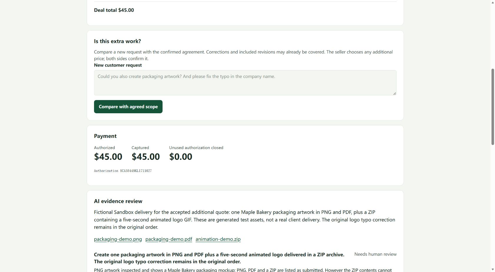

# HoldOn

HoldOn helps freelancers and clients decide whether a new request is already included, a correction, or additional work. It compares the request with their confirmed agreement and creates a separate order only after both sides accept a seller-written quote.

The local demo also supports PayPal authorization, delivery evidence, human acceptance and an AG Grid Community dashboard. AI suggests classifications and reviews evidence; it does not choose a price or take a payment.



For a guided evaluation, see [Judging setup and walkthrough](docs/JUDGING_GUIDE.md). A selected [verification summary](docs/verification-summary.json) is included without the private local ledger or credentials.

## How it works

1. Paste an agreement and a USD price. DeepSeek extracts deliverables, scope boundaries and revision terms. Buyer and seller confirm the same saved version; edits reset both confirmations.
2. Paste a new customer request. The scope review separates original work, corrections, included revisions, likely additional work and unclear requests. Its quotations must match the saved terms and request.
3. The seller selects what to quote and specifies the scope, price and delivery hours. Charging for an item not classified as additional work requires an explanation. Both sides review and confirm the quote.
4. One separate order is created with those exact terms. The original order and payment remain unchanged. The new deadline starts from the additional order's own authorization; it does not extend the original deadline.
5. Authorize each order through PayPal Sandbox, submit delivery evidence and record human acceptance. Full acceptance at the original price can proceed without a second seller settlement confirmation. Reduced settlement or waived items still require seller confirmation.

| Decision | Responsible component |
| --- | --- |
| Extract terms and identify suspicious requests | DeepSeek |
| Inspect images and assess each deliverable | DeepSeek |
| Compare new requests and cite confirmed scope | DeepSeek, with verbatim quotation checks |
| Set additional price and delivery window | Seller, subject to both parties' confirmation |
| Check file metadata and calculate amounts from human acceptance | Application code |
| Confirm capture or close an unused authorization | Buyer, following the applicable agreed settlement |
| Authorize, capture and void | PayPal Sandbox |

## Run locally

```sh
npm ci
npm run dev
```

Use Node.js 24 or later. Copy `.env.example` to `.env.local` and set the Sandbox app credentials and `DEEPSEEK_API_KEY` before starting. The app can also read credentials from its process environment. Use `LLM_PROVIDER=deepseek` and `LLM_MODEL=deepseek-flash`.

Open `http://127.0.0.1:3000`. Start a deal at `/deals/new` and see the overview at `/dashboard`. The interface provides Buyer and Seller views for a single operator to demonstrate both sides.

The JSON store and uploads stay in `data/`. Run one Node process against this directory. The API accepts local, same-origin mutations. Public deployment needs authentication, role permissions and a durable shared store.

## Main walkthrough: agree a scope change

Choose **Logo scope and revisions**. Confirm the original checklist and its non-priced boundaries in both views. Compare: “Please add packaging artwork and a five-second animated logo. Also fix the company name from Mapel Bakery to Maple Bakery in the original logos.”

Switch to Seller view, select only the extra deliverables, describe the proposed work and set a price and delivery window. Save the quote, confirm it as Seller, then confirm as Buyer. Open the separate order. Its checklist is locked to the accepted quote, and payment still needs a fresh buyer authorization. Quote edits before acceptance reset both confirmations. Repeated confirmations return the same child order.

On November 10, the real DeepSeek walkthrough classified packaging and animation as new work and the misspelled name as a correction. A $45 quote was entered and confirmed through the browser in both demo roles. The app created one linked $45 order while keeping the original at $120. HTTP checks verified duplicate confirmation, locked child terms, invalid actor rejection and unchanged stored records after rejected/repeated requests. No PayPal order was created or charged in this walkthrough. Evidence is in `data/SCOPE_CHECK.json` and `data/screenshots/scope-order.png`.

The first comparison had answered “unclear” for the extra work because extraction omitted the original exclusion clause. That run is retained. Extraction now preserves non-priced scope boundaries, shows them for both parties to confirm, and includes them in later comparisons. This is a synthetic example, not a measured classification accuracy or a real customer validation.

### Completed change-order payment check

Later on November 10, the same $45 change order completed its Sandbox round trip. The ordinary PayPal approval link returned to HoldOn and authorized $45. Three generated fixtures (packaging PNG, its PDF export, and a ZIP containing a five-second logo GIF) were uploaded through the application's HTTP multipart endpoint. Their downloaded bytes matched the originals; the GIF inside the ZIP decoded to 5,000 ms. The PDF signature was checked, but its rendered content was not independently inspected.

DeepSeek inspected the PNG and correctly left the ZIP contents for human review. Its suggested amount was $0. The browser rejected acceptance without an explanation. After explicit test acceptance notes were entered, the existing bilateral agreement allowed full-price payment without another seller settlement confirmation. The buyer's browser control completed one $45 capture.

A separate official PayPal API read confirmed order `COMPLETED`, authorization `CAPTURED`, and exactly one $45 `COMPLETED` capture with `final_capture: true`. A repeated release request returned the existing result; a changed amount was rejected. The original $120 order still had no payment order or capture. No real money was used. Full evidence is in `data/SCOPE_PAYMENT_CHECK.json`, with `data/screenshots/scope-payment-completed.png` showing the app result. This check used the approval link, not the SDK popup callback, and one operator exercised both fictional demo roles.

### Other checks: delivery and payment-risk samples

1. On **Start a deal**, choose **Maple Bakery logo** and run the analysis. This sends a fictional sample conversation to DeepSeek.
2. Review the checklist and scope terms, then confirm them in both demo views before checkout. Approve payment using a Sandbox Personal buyer. If the popup cannot complete, use **Open PayPal approval link** for the same order.
3. Switch to **Seller view**, attach both PNGs from `samples/delivery/`, and describe the two concepts supplied. Submit the delivery. Uploaded PNG, JPEG and WebP images are sent to DeepSeek along with the checklist and note. Other supported files supply metadata only.
4. Switch to **Buyer view**, select the items you accept and save the proposal. **Select all AI-supported items** is an explicit convenience action, not automatic acceptance. Accepting beyond AI evidence requires a reason. For reduced settlement, switch to Seller view to confirm before the buyer pays and closes the balance. Full acceptance uses the already-confirmed original agreement.
5. Choose **Concert tickets** on a new deal to check refusal of the gift-card-only agreement.

### Earlier payment run (before the human-acceptance revision)

On November 10, 2026 (Hong Kong time), the revised extraction produced six items totaling $120. Two actual PNGs were submitted. The verifier recognized two distinct concepts and PNG delivery. The third concept and SVG were missing. It also rejected the checklist's complete-delivery-within-48-hours item because the set was incomplete. The computed release was $65, and the application captured $65 and closed the remaining $55 authorization.

A follow-up PayPal API check found one completed capture and a voided authorization. Repeating the same release returned the existing result. A changed amount and an edit to the locked checklist were rejected. The gift-card scenario was marked `do_not_pay`, and its payment endpoint refused to create an order. Local records are in `data/END_TO_END_CHECK.json` and `data/GIFT_CARD_CHECK.json`.

The PayPal SDK button created the application order. Browser automation timed out inside its popup, so buyer approval used the same order's ordinary approval page. The return-page authorization, upload, verification and release controls were exercised through the application. The full popup callback still needs browser verification.

The initial extraction grouped all three concepts under one $75 item with zero-valued children. That record remains available. The extraction instructions were revised to preserve itemized prices and avoid overlapping parent and child items. The earlier verifier also rejected incomplete delivery before the deadline. The current version keeps that timing condition pending and prevents a deadline attached to a deliverable from overriding missing content. AI assessments are advisory; human acceptance now determines payment. The earlier $65 capture proves the previous payment flow, not an end-to-end test of the new consent and change-order flows.

## Verify PayPal Sandbox

1. Sign in to the [PayPal Developer Dashboard](https://developer.paypal.com/dashboard/). Under **Apps & Credentials → Sandbox**, create an app for your Sandbox Business account. Under **Testing Tools → Sandbox Accounts**, locate a separate Personal test buyer.
2. Copy `.env.example` to `.env.local` and set `PAYPAL_CLIENT_ID` and `PAYPAL_CLIENT_SECRET` to the Sandbox app credentials. Keep the file local.
3. Run `npm run paypal:smoke -- create`. Open the printed approval link and approve the $120 USD order as the Sandbox Personal buyer.
4. Run the printed `npm run paypal:smoke -- finish ORDER_ID` command. It checks the approval, authorizes $120, captures $80 with `final_capture: false`, and attempts to void the remaining authorization. If the void succeeds, it checks for `VOIDED`.
5. If PayPal rejects the void after partial capture, keep that result and run `npm run paypal:smoke -- create final` to try `final_capture: true` on a fresh Sandbox order. Approve and finish the new order as above.

The `finish` command checks the current order state and uses the same request ID for a repeated capture on that order. Each `create` command starts a separate Sandbox order. The script records payment IDs, states and amounts in the local `data/paypal-smoke.jsonl` file.

## PayPal notes

- Verified with PayPal Sandbox on November 10, 2026 (Hong Kong time). A Personal test buyer approved $120 USD using their Sandbox balance. PayPal authorized $120 and completed an $80 partial capture with `final_capture: false`. Voiding the authorization closed the unused $40. A follow-up API check found the order `COMPLETED`, one $80 capture still `COMPLETED`, and the authorization `VOIDED`.
- The script uses OAuth client credentials, Orders v2 create/get/authorize, and Payments v2 authorization get/capture/void. It connects to the Sandbox API only.
- PayPal describes a three-day honor period and a 29-day authorization period. Longer fulfillment windows may require [reauthorization](https://developer.paypal.com/payment-methods/auth-honor/).

## Checks

```sh
npm test
npm run typecheck
npm run build
```

The 26 automated tests cover cents allocation, grounded quotations, scope-term edits, full versus reduced settlements, quote revision invalidation, atomic/idempotent child creation, deadline/content separation, cumulative evidence, origin checks and recovery after capture succeeds but voiding fails. They use simulated API responses and temporary storage. The separate live AI and browser walkthrough is described above.

## Scope and next work

This build supports one capture per deal and ten scope reviews per deal. Additional quotes become separate orders. Evidence can be supplemented before settlement starts. A matching filename does not establish file contents; non-image files need human inspection. Model confidence is a routing signal, not proof. Scope comparison uses the confirmed checklist and scope terms, not unconfirmed original-chat claims; it has no automatic record of revision usage. Scope classifications do not independently verify a customer's report of a defect.

The application currently uses one Sandbox Business seller. Both demo roles are operated locally by one person and are not authenticated identities. Production onboarding needs authentication, role enforcement, durable storage and the relevant PayPal platform approvals. The change order's Sandbox authorization, test delivery, human acceptance and full capture have been verified as described above. The SDK popup callback, public hosting, webhooks and submission video remain separate work. No real-money or public deployment readiness is claimed.

## Built for the hackathon

The HoldOn application, payment checks, sample conversations and demonstration logo images were created for this project. The frontend uses Next.js, React, Tailwind CSS and AG Grid Community. The backend uses PayPal REST and [DeepSeek image input](https://api-docs.deepseek.com/guides/vision/) with [JSON output](https://api-docs.deepseek.com/guides/json_mode/).

Source is available under the MIT license in `LICENSE`.
